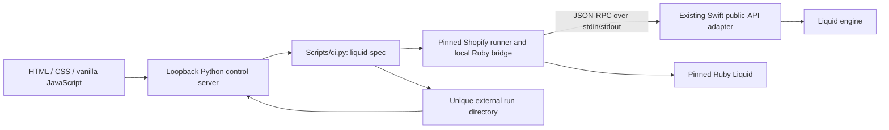

# Local conformance control center

The console currently presents the **raw** pinned suite result, including the
five reference conflicts as failures. The separate reviewed CLI lane and its
exclusion inventory are described in the [adapter guide](../Tools/LiquidSpecAdapter/README.md);
the console does not yet present that reviewed status.

This development tool makes the existing independent Shopify `liquid-spec` lane
usable from a browser. It wraps the existing runner; it does not introduce another
parser, renderer, value converter or comparison policy.

## Existing work and authority

[LQ1](LQ1/README.md) implemented the JSON-RPC adapter, protocol and bridge tests,
eligibility matrix, original comparator verdicts and stricter phase qualification.
[R2](LQ1-R2/README.md) added diagnostic evidence; [R6](LQ1-R6/EXPECTED_TOKEN_DIAGNOSTICS.md)
improved nineteen expected-token identities. The [conformance record](Conformance.md)
keeps exact historical source identities and failed snapshots.

The console retains `liquid-spec` at
`84bf25e0edbca5f7e530574788b0f875ab331f50` and Ruby Liquid at
`4e39ae4cc3da73921923c0669e0fc84a66b2f696`. The official
[protocol](https://github.com/Shopify/liquid-spec/blob/84bf25e0edbca5f7e530574788b0f875ab331f50/docs/json-rpc-protocol.md)
connects engines as subprocesses. There is no dependency on a global Shopify
testing endpoint. Root products, dependencies, public API and platform floors do
not change. JSON-RPC remains isolated development tooling, not a new `liquid` mode.

## Run contract

1. Observe the clean source commit/tree, Swift/Ruby versions, exact upstream pins
   and clean inputs, and existing pinned development gems.
2. Capture every tracked source hash and allocate a new private external run
   directory. Reject an overlapping run in the same console.
3. Invoke the existing canonical lane with `--output-root`. This option is limited
   to `liquid-spec` and `conformance-console`; all existing lane defaults stay intact.
4. Show actual checkpoints and phase progress. Do not invent a completion percentage
   or reinterpret a partial matrix as a complete observation.
5. Verify ending source identities, source inventory joins, report hashes and full
   row accounting. Display the canonical qualified outcomes without recomparing
   outputs. Retain original upstream and Ruby-reference verdicts alongside them.
6. Preserve every result, including runner failure, cancellation and timeout.
   Downloads expose original owned evidence files through fixed, bounded routes.

The five pinned suites are `basics`, `liquid_ruby`, `liquid_ruby_lax`, `parser_errors`
and `partials`. Parser-mode expansion, inline/raising policies, primitive-JSON
admission, finite limits and clock behavior retain their existing contracts.
Production recordings, Dawn, Ruby host objects and performance studies do not become
supported by adding a graphical interface. Exact-name registry API qualification
remains separate from this legacy dictionary-based adapter's partial transport.

## Presentation and failure semantics

The interface follows the sibling MCP conformance dashboard's pale sidebar, white
workspace, teal actions and evidence tables. The counts and case data come from
the selected Liquid run. Empty values, setup failures and partial states are
explicit. No MCP counts, prefilled passing cases or synthetic conformance scores
are shipped as results.

Raw comparator matches can still fail qualification because of phase, domain or
operational behavior. Reference concerns remain visible. Source corruption or
incomplete evidence is a runner error; it cannot produce a successful conformance
state. A historical snapshot belongs to its original SHA and is never relabelled
as a fresh run on the current branch.

## Boundaries and qualification

The browser uses same-origin JSON requests to a loopback-only stdlib HTTP server.
Token bootstrap, port-scoped HttpOnly cookies, Host/Origin checks, a restrictive
content policy and code-native text rendering protect the local control surface.
No private input, credential or source file browser is exposed. Run storage stays
outside Git, and only the console's current owned subprocess group can be stopped.
This is not a replacement for OS sandboxing or a hosted service.

Tool changes use the `conformance-console` lane for meaningful control tests and
browser interaction/desktop/mobile inspection. A full functional observation must
run on the final clean committed source and retain its real exit and case results.
Neither UI tests nor successful transport can turn the historical independent
failure green. Timings, publication, hosted automation, dashboard deployment and
runtime compatibility repairs require their own scope; they are not triggered by
opening this tool.

See [launch and setup](../Tools/ConformanceConsole/README.md).
